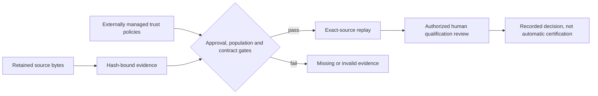

# Assurance enforcement and remaining qualification work

Version 0.83.0 strengthens evidence acceptance; it does not certify a product or claim
that the scanner is a qualified NASA/FAA tool. Guidance mappings support review, not approval.



## What is enforced

| Area | Acceptance condition | Boundary |
| --- | --- | --- |
| Scope approval | Ed25519 signature over the portfolio, matching authorized identity, role, dates and revocation policy | Trust-policy administration and key custody remain organizational responsibilities |
| Evaluation drift | Baseline and windows have identical case IDs, dataset digest and oracle digest | Matching declarations do not establish oracle correctness |
| Telemetry population | Pinned collection record reconciles request count, declares no drops and sampling probability 1 | Counter attribution is required; counter independence/authenticity still needs review |
| Circuit breaker | Timed request replay demonstrates opening, rejection, cooldown, probes and recovery | Sequential consecutive-failure policy only; concurrent histories are rejected |
| Inspect conformance | Exact schema bytes, version, URI and configuration projection match a caller-selected policy | Policy approval is not an upstream publisher signature |
| Callgraph comparison | Exact expected/predicted adjacency edges with TP/FP/FN, precision, recall and replay | Requires a complete reviewed oracle; runtime traces alone cannot establish negative labels |

Malformed OTLP record lists, duplicate attribute keys and ambiguous AnyValue variants are rejected
instead of silently disappearing from evidence. This is targeted intake hardening, not full OTLP conformance.

## Trust configuration

Do not let analyzed repositories select their own trust roots. Keep policies and approval keys under
separate organizational control. Public schemas document their closed input fields:

- `scope-trust-policy`: format `pysfmea-scope-trust-policy-1`; `authorities` entries contain
  `identity`, `public_key`, `roles`, `not_before`, `not_after`, and `revoked`. The required role is
  `scope-approver`; timestamps include timezones. Relative key paths resolve under the policy directory.
- The scoped portfolio's `approval_ref` names a detached signature relative to the portfolio.
  Sign the final portfolio with `assurance-evidence-sign`; edits require a new signature. Pass the
  external policy using `--scope-trust-policy` to qualification assessment and exact-source verification.
- `upstream-schema-policy`: format `pysfmea-upstream-schema-policy-1`; `schemas` entries contain
  `tool: "Inspect AI"`, `version`, `uri`, `sha256`, and
  `configuration_projection: "inspect-export-config-1"`. Obtain and review the upstream schema
  independently, then pass `--schema-policy` to Inspect conformance assessment and verification.

Missing policies prevent eligibility; the tool never fabricates an authorized approval.

## Measurement inputs and migration

Regenerate affected outputs from retained source evidence. Do not merely relabel old receipts.

- Deployed TEVV source, assessment and verification move to format/schema major **3**.
- Inspect conformance and qualification readiness receipts/verifications move to major **3**.
- Raw evaluation and control event contracts move to major **2**. Evaluations require
  `dataset_sha256` and `oracle_sha256`; baseline/window case populations must match.
- Every TEVV window adds `collection_ref` and `collection_sha256`. The `tevv-collection` schema
  defines its window/timestamps, telemetry digest, expected request count, dropped records,
  sampling probability, counter source and `one-span-per-request` population.
- Breaker controls replace untimed transitions with `breaker_policy` (`failure_threshold`,
  `cooldown_seconds`, `half_open_successes`) and `requests` (`id`, `started_at`, `completed_at`,
  `outcome`, `state_before`, `state_after`). A failed half-open probe restarts the cooldown.

See [schema catalog](SCHEMAS.md) and executable fixtures in
`tests/test_deployed_tevv.py` and `tests/test_measurement_enforcement.py` for complete examples.

## Comparing callgraphs

Use [PyCG simple JSON adjacency format](https://github.com/vitsalis/PyCG#simple-json-format),
for example `{"module.caller": ["module.callee"]}`. Use identical symbol naming and source revision.

```powershell
sfmea callgraph-benchmark expected.json actual.json --revision REVIEWED_COMMIT --authority REVIEWER -o comparison.json
sfmea callgraph-benchmark-verify comparison.json expected.json actual.json
```

The report retains each missing/spurious/matched edge. Empty denominators yield `null`, not a
perfect score. This is a comparison primitive, not a PyCG execution adapter or independent campaign.

## CI and release operation

- `assurance-mutation.yml` adds a separate **80% acceptance target** for three enforcement modules.
  The target is not a measured score until its Linux workflow has run successfully.
- Critical branch-aware coverage floors now include measurement validity (80%), scope
  authentication (80%) and upstream contract approval (90%). These are regression floors,
  not claims that coverage establishes correctness.
- The measurement fuzz target is picked up by the existing ClusterFuzzLite build; adding it is not
  evidence of a completed fuzz campaign.
- `release-candidate.yml` is manual and main-only: validate, build, audit, produce SBOM, attest,
  verify exact source/workflow and hosted-runner provenance, then retain the candidate.
  It does not publish a package or release.
- Configure required reviewers for the `release-candidate` GitHub environment before using it.
  Merely declaring an environment does not enforce approval. Run the workflow and retain verified
  artifacts before claiming hosted provenance. Reproducible builds and a SLSA level are not asserted.

This follows the separation between provenance production and verification in
[GitHub artifact attestation guidance](https://docs.github.com/en/actions/how-tos/secure-your-work/use-artifact-attestations/use-artifact-attestations)
and [SLSA build-track requirements](https://slsa.dev/spec/v1.2/build-track-basics).

## Still requires real evidence

The existing catalog retains **17 contract-only adapters**; this tranche does not relabel them as
implemented. Independent PyCG/TestGenEval and other benchmark campaigns, complete reviewed oracles,
authenticated upstream fixtures, reviewer independence, protected-environment configuration, actual
mutation/fuzz campaigns, and concurrent breaker validation remain separate work. Tests4Py is not
integrated. No favorable results or third-party approvals are synthesized to fill those gaps.
