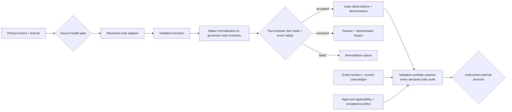
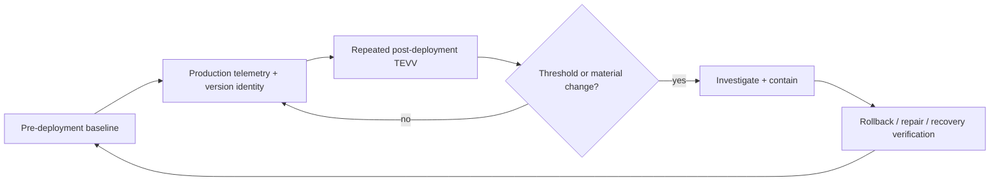

# Benchmark quality and deployed-AI TEVV

For 0.83.0 trust policies, major-3 receipt migration, paired cohorts, telemetry collection
accounting and timed breaker inputs, see [Assurance enforcement](ASSURANCE_ENFORCEMENT.md).

PySFMEA separates benchmark registration, source qualification, execution, item validity, metric
calculation, and external acceptance. No single artifact is allowed to imply all six.

## Evidence flow



`benchmark-item-quality` closes a common benchmark soft spot: a reproducible harness can still
measure the wrong thing. Every normalized case must have all nine criteria, evidence references,
and at least two reviewers independent of the audit authority. Core criteria cannot be marked not
applicable. Exact population equality prevents quiet omission; exclusions are rate-limited and
reported separately; remediation items block a pass. `benchmark-case-inventory` provides the same
closed review population for internal, direct, or contract-only suites without inventing external
result semantics. The validation portfolio requires exact audit coverage of its suite set, and the
top qualification gate independently checks that portfolio result.
Use `benchmark-case-inventory-verify --manifest ...` to prove that an inventory still exactly
replays from the raw manifest; the sealed inventory is then the population input replayed by the
item audit.

## Review input shape

```json
{
  "case_id": "repository__issue-123",
  "disposition": "accepted",
  "criteria": {
    "requirements_complete": {
      "status": "pass",
      "rationale": "The task states observable behavior and boundaries.",
      "evidence_refs": ["evidence://review/task-123"]
    }
  },
  "reviewers": ["reviewer alpha", "reviewer beta"],
  "exclusion_reason": "",
  "notes": "The real record contains all nine criteria."
}
```

The criteria are `requirements_complete`, `oracle_valid`, `hidden_tests_reasonable`,
`coverage_adequate`, `mutation_adequate`, `harness_reproducible`, `ambiguity_resolved`,
`gold_patch_valid`, and `regression_tests_valid`.

## Fresh and portable evaluation evidence

SWE-bench Live is registered as a native, time-bounded target. Its normalized evidence preserves
`success`, `failure`, `incomplete`, and `error` separately plus available month, repository,
platform, image, harness, and evaluator context. Campaigns must pin dataset and
evaluator revisions, repository and month strata, platform and images, predictions, exclusions,
errors, incomplete instances, and item audits. Live status never permits a moving denominator.

Inspect AI JSON intake binds the exact log bytes and records evaluation/run identity, task/model
configuration hashes, sandbox declaration, sample and epoch identities, scorer values, transcript
and store hashes, tool-event counts, errors, and token usage. `inspect log schema` remains the
official upstream schema check. `inspect-ai-conformance` validates the retained log against the
supplied upstream schema, compares the JSON configuration produced by `inspect log export-config
--format json` against the reproducible task/model/solver/generation/evaluation/sandbox configuration
in the retained log, preserves typed execution identity, and exactly replays all four inputs. PySFMEA
does not authenticate the supplied schema, reinterpret scorer semantics, or infer model safety.

Terminal-Bench 2.0 now has a conservative Harbor native-JSON importer: provide an array of retained
single-step `TrialResult` objects (or an object with that array under `results`). Pin the suite
revision. Each task checksum and trial name identifies an attempt; binary `reward` values map to
success/failure, while exceptions and unfinished trials remain error/incomplete. Fractional,
multi-reward, and multi-step results are rejected. This is not a full Harbor job-directory importer
or a qualified execution harness. Errors and incomplete attempts remain visible in the population.

```powershell
sfmea benchmark-native-normalize harbor-trials.json --suite terminal-bench-2 `
  --revision "<retained-dataset-revision>" --authority "Evaluation laboratory" `
  -o terminal-bench.normalized.json
```

The adapter follows [Harbor's retained result model](https://github.com/harbor-framework/harbor/blob/main/src/harbor/models/trial/result.py).
Inspect mapping follows [upstream exported configuration](https://github.com/UKGovernmentBEIS/inspect_ai/blob/main/src/inspect_ai/log/_config.py).

## Deployed monitoring



The `deployed-tevv-*` workflow turns the monitoring loop into a deterministic, source-replayable
gate. It joins exact model, prompt, tool-policy, and system identity; pre-deployment baseline;
ordered monitoring windows; evaluation counts; error, latency, and drift thresholds; all six NIST
AI 800-4 monitoring categories; incidents; circuit-breaker activation; rollback and recovery; and
versioned telemetry. `genai-telemetry-*` imports OTLP JSON through a version-pinned OpenTelemetry
GenAI attribute subset and requires operation/provider identity before TEVV eligibility. Because
the GenAI conventions may be experimental, stability and version remain explicit evidence fields.

The implemented mapping is **1.37.0 / development**, not an arbitrary version label. Unknown
versions, mismatched stability, and mixed legacy aliases are rejected. See the
[pinned upstream attribute registry](https://github.com/open-telemetry/semantic-conventions/blob/v1.37.0/model/gen-ai/registry.yaml).

### Retained measurements, not asserted summaries

| Input contract | Recomputed or checked |
| --- | --- |
| `tevv-request-events` | Unique request IDs, half-open window timestamps, deployment identity, errors, nearest-rank p95 latency |
| `tevv-evaluation-events` | Unique case IDs, dataset/oracle identity, paired baseline/window population, count and pass rate |
| `tevv-collection` | Pinned request denominator, no drops, full sampling and explicit population |
| `tevv-control-events` | Timed sequential breaker requests, failure threshold, cooldown, probes and recovery; rollback elapsed time |
| Change records | Ordered baseline-to-current version chain, approval evidence, regression evaluation, no change inside a window |

`drift_score` means absolute change in evaluation pass rate from baseline in this contract; it is
not a general distribution-drift statistic. Thresholds remain governed product policy, not
NIST-mandated numeric values. Baseline/window files are raw-SHA-256 pinned; assessment
`evidence_digests` also binds the parsed JSON of retained controls, approvals, and regressions.
Missing files, substitutions, and inconsistent summaries block eligibility.

OTLP JSON can feed the same TEVV path with `telemetry_schema` set to
`OpenTelemetry GenAI semantic conventions` and `telemetry_schema_version` to `1.37.0`.
Resource `service.version` must match the window system version; custom resource
`pysfmea.model.version` must match its model revision. `gen_ai.request.model` must match the
declared model. This bridge measures GenAI spans, not all application traffic; choose the request
population explicitly and avoid mixing parent/child spans as if each were an independent request.

## Scored population and applicability

Every portfolio `item_quality` record now needs an `execution_path` to retained
`benchmark-case-results` JSON. Its `suite_id`, `suite_revision`, and `source_sha256` must match the
audit and declared suite; `cases` contains `case_id`, `repository_id`, boolean `executed`, and
`metrics` keyed by metric name with boolean `expected` and `predicted` values. The case population
must exactly equal the audit. Accepted cases must execute and reproduce the retained per-repository
confusion counts; excluded cases carry no scored metrics. An independently valid audit alone does
not establish that the scored population was audited.

Qualification may use an explicitly approved applicable subset of the catalogs:

```powershell
sfmea validation-portfolio-scope portfolio.json `
  --standard nasa-7150-8739-software-assurance `
  --owner "Product owner" --reviewer "Independent reviewer" --approver "Assurance board" `
  --approval-ref "portfolio.scoped.sig.json" `
  --approved-at "2026-09-01T00:00:00Z" --next-review-at "2026-10-01T00:00:00Z" `
  --exclusion-rationale "Outside this reviewed product use case" -o portfolio.scoped.json
```

Use actual IDs from `standards-catalog` and repeat `--standard` as needed. Required suites come
from the portfolio. Review every generated exclusion rationale before acceptance: the command
records the supplied decision; it does not grant approval. Scope binds intended use and exact
acceptance policy, requires three distinct roles, expires, accounts for every catalog entry, and
records product/model/dataset/standard/adapter/policy change triggers. Reassess the scoped portfolio
with source-health revisions and snapshot digests matching its declared benchmark sources
before the readiness gate. Sign the final scoped portfolio and supply an externally managed
`--scope-trust-policy` to readiness assessment and replay. Without scope, the exhaustive catalog
checks remain, but authenticated scope approval is still required for readiness. There are currently
24 native/direct and 17 contract-only targets; selected contract-only targets still block readiness.

Version 0.82.0 introduced major-2 assurance contracts. Version 0.83.0 advances Inspect conformance,
deployed TEVV and qualification readiness to major 3, and raw evaluation/control inputs to major 2.
Regenerate from retained sources; never relabel old receipts to bypass stronger checks.

The `nist-ai-800-4-deployed-monitoring` profile connects monitoring plans, versioned telemetry,
longitudinal drift, repeated TEVV, incidents, containment, rollback, and residual-risk disposition.
The NIST AI 200-2 TEVV-Athlon initial public draft remains in `standards-watchlist`; it cannot
satisfy a normative profile until publication and accountable adoption.

## Claim boundaries

- A registered suite is not an acquired or executed benchmark.
- A native adapter is not source, label, or harness qualification.
- A passing item audit is not proof of reviewer competence or representativeness.
- A valid Inspect intake is not a scorer, sandbox, or model-safety verdict.
- A valid experimental telemetry mapping is not stable OpenTelemetry conformance or proof of
  monitoring completeness.
- A complete PySFMEA package is evidence for an authorized decision—not certification,
  accreditation, regulatory approval, legal compliance, or risk acceptance.
