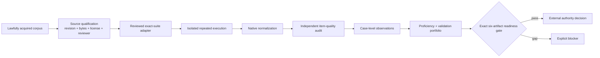

# Independent evidence campaign

This procedure turns registry coverage into reproducible, reviewable validation evidence. It is
inspired by ISO/IEC 17025 method control and ISO/IEC 17043/ISO 13528 proficiency principles, but
does not claim laboratory accreditation, proficiency-provider accreditation, product conformity,
or regulatory approval.

## Control model



Roles must be attributable and separated where required:

- source custodian acquires the exact lawful snapshot and license evidence;
- independent source reviewer confirms identity, revision, license evidence, and review interval;
- adapter owner implements the version-specific mapping;
- independent adapter reviewer challenges identity, exclusions, labels, metrics, and failure paths;
- execution operator runs the frozen protocol without changing labels or acceptance criteria;
- label authority owns ground truth and adjudicates ambiguity;
- item reviewers independently challenge requirements, oracles, tests, harnesses, ambiguity,
  exclusions, and denominator impact; at least two distinct reviewers are required per case;
- validation assessor calculates predeclared measures and uncertainty;
- decision authority accepts, rejects, or limits use and must not be an evidence-producing role.

## 1. Qualify every source

Start with the closed 41-suite ledger. Qualify one suite only from locally retained bytes; the
command hashes the snapshot and license evidence, requires a reviewer different from the ledger
authority, and refuses a non-canonical URL or invalid review interval.

```powershell
sfmea benchmark-source-health-init --authority "Benchmark board" -o sources.json
sfmea benchmark-source-qualify sources.json `
  --suite agentdojo `
  --snapshot C:\evidence\agentdojo-v1.2.2 `
  --revision v1.2.2 `
  --observed-url https://github.com/ethz-spylab/agentdojo `
  --license-id MIT `
  --license-evidence C:\evidence\agentdojo-LICENSE `
  --schema-version "TaskResults v1.2.2" `
  --reviewer "Independent source reviewer" `
  --next-review-at 2027-02-28T00:00:00Z `
  -o sources.agentdojo.json
sfmea benchmark-source-health-verify sources.agentdojo.json --json
```

Chain the output ledger through every remaining suite. The ledger can be structurally valid while
`eligible_for_external_execution` remains false; that is the expected state until all 41 sources
are complete and every source reviewer is detached from the ledger authority. Never substitute a
URL, branch name, package version, or downloaded timestamp for an immutable revision and digest.

## 2. Review the adapter

Create a suite-specific contract, fill the exact source/image/command/output schema and independent
review fields, then seal and verify it. A native parser only preserves upstream fields; it does not
establish that the source, runner, labels, or results are trustworthy.

```powershell
sfmea benchmark-adapter-init --suite agentdojo --authority "Adapter owner" -o adapter.json
sfmea benchmark-adapter-seal adapter.json -o adapter.sealed.json
sfmea benchmark-adapter-verify adapter.sealed.json --json
```

AgentDojo preserves security and utility as distinct outcomes. SWE-PolyBench preserves resolution,
fail-to-pass, pass-to-pass, patch application, retrieval, and harness errors. IDoFT membership is a
candidate positive label and absence from IDoFT is never a negative label.

## 3. Audit every benchmark item

Normalize the exact upstream result population, then audit every case. Each criterion requires a
rationale and evidence reference. Accepted items must pass the core requirements, oracle, hidden-
test, harness, and ambiguity checks; every failed criterion must enter remediation. Exclusions need
a reason and cannot exceed the predeclared rate. The audit authority cannot act as an item reviewer.

```powershell
sfmea benchmark-native-normalize swe-live-results.json `
  --suite swe-bench-live --revision commit:0123456789abcdef `
  --authority "Execution laboratory" -o swe-live.normalized.json
sfmea benchmark-item-quality swe-live.normalized.json reviews.json `
  --authority "Benchmark quality board" --max-exclusion-rate 0.05 `
  -o item-quality.json
sfmea benchmark-item-quality-verify item-quality.json `
  --normalization swe-live.normalized.json --reviews reviews.json --json
```

For a direct or contract-only suite, create an exact case population without guessing its result
schema:

```powershell
sfmea benchmark-case-inventory terminal-bench-task-manifest.json `
  --suite terminal-bench-2 --revision commit:0123456789abcdef `
  --authority "Population custodian" --adapter-mode native-json `
  --population-basis "Pinned official task manifest after preregistered eligibility review" `
  -o terminal-bench.inventory.json
sfmea benchmark-item-quality terminal-bench.inventory.json terminal-bench.reviews.json `
  --authority "Benchmark quality board" -o terminal-bench.item-quality.json
```

Local integrity alone is not claim eligibility. `eligible_for_benchmark_claim` becomes true only
after the audit exactly replays from both bound source artifacts.

## 4. Pre-register and execute

Before execution, freeze the population, strata, exclusions, attempts, seeds, model and prompt
identity, tool policy, judge policy, environment image, resource budgets, stopping rules, measures,
thresholds, and adjudication procedure. Use network-denied, read-only, digest-pinned campaign
execution where the suite permits it. Retain failures caused by setup, dependency, timeout,
instrumentation, refusal, sandbox, judge, and harness behavior as typed outcomes.

Normalize exact upstream output without editing it:

```powershell
sfmea benchmark-native-normalize agentdojo-results.json `
  --suite agentdojo --revision v1.2.2 `
  --authority "Execution operator" -o agentdojo.normalized.json
sfmea benchmark-native-verify agentdojo.normalized.json --json
```

Inspect AI JSON logs can be retained as portable evaluation evidence without reinterpreting scorer
semantics:

```powershell
sfmea inspect-ai-import inspect-log.json --authority "Evaluation evidence board" `
  -o inspect-evidence.json
sfmea inspect-ai-verify inspect-evidence.json --source inspect-log.json --json
sfmea inspect-ai-conformance inspect-evidence.json inspect-log.json `
  inspect-schema.json inspect-run-config.json --authority "Interop laboratory" `
  --inspect-version 0.3.206 --schema-uri https://inspect.aisi.org.uk/schema/eval-log-v2 `
  -o inspect-conformance.json
```

## 5. Required measures

Report counts and intervals, not percentages alone. At minimum:

| Claim | Required evidence |
|---|---|
| Failure-mode discovery | precision, recall, unsupported-claim rate, source-localization accuracy, strata |
| Causal propagation | ordered-path edge precision/recall, effects, deadline, breaker transition, recovery |
| Generated tests | generation/execution rate, fail-to-pass, pass-to-pass, mutation delta, unsafe oracle, flakiness |
| Repository generalization | SWE-PolyBench Python resolution and retrieval measures, per-project results |
| Fresh coding tasks | SWE-bench Live Python resolution, errors/incomplete cases, repository/month strata, contamination window |
| Agent security | benign utility, utility under attack, security under attack, attack success, defense deltas |
| Nondeterminism | detection precision/recall, reproduction distribution, order/schedule strata, false stability |
| Operations | wall time, peak memory, token/cost totals, error taxonomy, repeatability by environment |

Publish Wilson or justified equivalent confidence intervals for proportions, repetition variability
for stochastic measures, every exclusion with denominator impact, and paired comparisons when tools
share cases. Separate deterministic oracles, runtime observations, upstream labels, model-judge
decisions, and human adjudication.

## 6. Independent proficiency and release gate

Run at least two organizational participants over stable blinded items under the controlled
proficiency workflow. Preserve assigned values, uncertainty, homogeneity/stability evidence,
z-scores or qualitative agreement, corrective actions, and exact source replay. Then join the
source ledger, proficiency evidence, standards lifecycle, and independently regenerated validation
portfolio through `industry-qualification-readiness`.

Release eligibility requires all of the following:

Without an approved scope, applicability defaults to the entire catalog. Use
`validation-portfolio-scope` to record a reviewed subset, rationale for every exclusion, approval
and expiry, and exact acceptance policy; reassess before readiness. See
[scored population and applicability](BENCHMARK_QUALITY_AND_TEVV.md#scored-population-and-applicability).

- every selected standards lifecycle record is reviewed, current, and evidence-backed;
- every applicable benchmark source is complete, pinned, licensed, current, and independently reviewed;
- every claim-bearing benchmark population has a passing, exactly replayed item-quality audit;
- every applicable adapter is operational and independently reviewed—no contract-only claim;
- the proficiency round passes with exact source replay and separated authorities;
- the validation portfolio has an exactly replayed passing item audit for every declared suite and
  passes all benchmark, runtime, interoperability, usability, formal-method, and continuity gates;
- the aggregate assessment regenerates exactly from all six source artifacts;
- unresolved anomalies, uncertainty, limitations, and residual-risk decisions remain visible.

A passing gate means only that the evidence package is eligible for an identified external
authority's review. It never grants certification, accreditation, legal compliance, safety
approval, model qualification, or permission to deploy generated tests.
